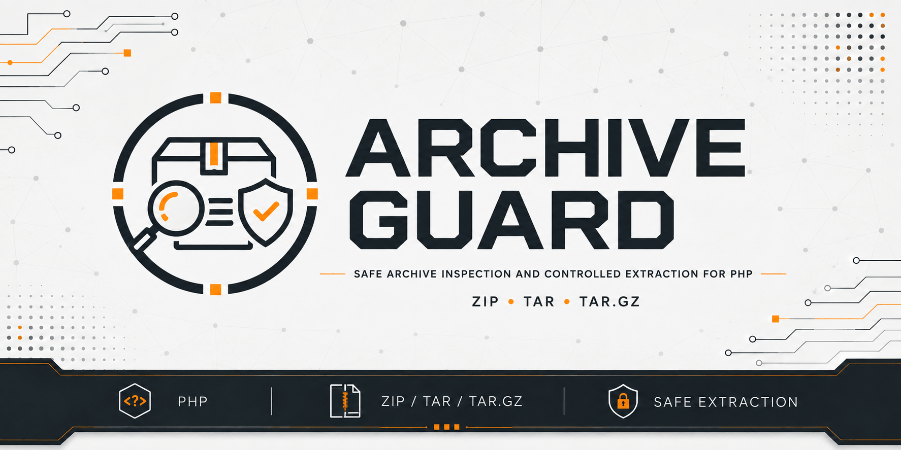

# Archive Guard

[](https://github.com/yaleksandr89/archive-guard)
[](https://github.com/yaleksandr89/archive-guard/actions/workflows/ci.yml)
[](https://packagist.org/packages/yaleksandr89/archive-guard)
[](https://packagist.org/packages/yaleksandr89/archive-guard)
[](https://www.php.net/)
[](../../../LICENSE)



## Sprache auswählen

| Русский | English | Español | 中文 | Français | Deutsch |
|---|---|---|---|---|---|
| [Русский](../../../README.md) | [English](../en/README.md) | [Español](../es/README.md) | [中文](../zh/README.md) | [Français](../fr/README.md) | **Ausgewählt** |

Archive Guard ist eine PHP-Bibliothek zum Prüfen von ZIP-, TAR- und TAR.GZ-Archiven vor dem
Entpacken und zum Extrahieren von Dateien mit vorgegebenen Grenzen.

## Wofür das Paket gedacht ist

Wenn eine Anwendung ein Archiv von einem Benutzer oder einem externen Dienst erhält, sollte
vor dem Entpacken geprüft werden, ob es keine gefährlichen Pfade, Links oder nicht unterstützten
Elemente enthält und ob Archivgröße sowie entpacktes Datenvolumen innerhalb der von der
Anwendung erlaubten Grenzen bleiben.

Das Paket kann ein Archiv vor dem Entpacken separat prüfen oder Prüfung und Extraktion in
einem Schritt durchführen. Besteht das Archiv die Prüfung nicht, erhält die Anwendung einen
konkreten Grund.

## Was das Paket macht

- erkennt Formate am Dateiinhalts statt am Namen;
- prüft Archivpfade, Kollisionen nach Normalisierung und Namenskompatibilität der Plattform;
- lehnt symbolische Links, Hardlinks, besondere Objekte und nicht unterstützte Formatfunktionen ab;
- begrenzt Archivgröße, Eintragszahl, entpackte Einzelgröße und gesamtes entpacktes Volumen;
- prüft die tatsächliche Lesbarkeit akzeptierter ZIP-Daten zusätzlich zu den Metadaten;
- prüft und extrahiert verschlüsselte ZIP-Dateien mit Passwort, sofern `ZipArchive`/`libzip` das Verfahren unterstützt;
- extrahiert per Atomic in ein neues Verzeichnis oder per Merge mit `Reject`, `Skip` oder `Overwrite` in ein bestehendes Verzeichnis;
- liefert typisierte Ergebnisse und strukturierte Ablehnungsgründe.

Unterschiede zwischen ZIP, TAR und TAR.GZ stehen in der [Formatreferenz](reference/supported-archives.md).

## Anforderungen

- PHP `>=8.4 <8.6`;
- `ext-zip`;
- `ext-zlib`.

## Schnellstart

### Archiv prüfen

[`ArchiveGuard::inspect()`](../../../src/ArchiveGuard.php) prüft ein Archiv, ohne Dateien zu
extrahieren. Grenzen werden über [`ArchivePolicy`](../../../src/ArchivePolicy.php) festgelegt.

<details>
<summary>Prüfbeispiel anzeigen</summary>

```php
<?php

use Yaleksandr\ArchiveGuard\ArchiveGuard;
use Yaleksandr\ArchiveGuard\ArchivePolicy;

$archivePath = '/path/to/archive.zip';

// Wähle Grenzen passend zu den realen Archiven und Ressourcen der Anwendung.
$policy = new ArchivePolicy(
    maxArchiveBytes: 50_000_000,
    maxEntries: 1_000,
    maxEntryUncompressedBytes: 10_000_000,
    maxTotalUncompressedBytes: 100_000_000,
);

$inspection = new ArchiveGuard()->inspect($archivePath, $policy);

if ($inspection->isAccepted()) {
    echo 'Archiv hat die Prüfung bestanden.' . PHP_EOL;
} else {
    foreach ($inspection->violations() as $violation) {
        // code kennzeichnet den Ablehnungsgrund; message enthält die Textbeschreibung.
        echo $violation->code->value . ': ' . $violation->message . PHP_EOL;
    }
}
```

</details>

Für verschlüsselte ZIP-Dateien wird das Passwort im selben Aufruf übergeben:

```php
$inspection = new ArchiveGuard()->inspect(
    $archivePath,
    $policy,
    password: $password,
);
```

`password` gilt nur für ZIP. TAR und TAR.GZ haben keine integrierte Passwortverschlüsselung; ein Wert ungleich `null` führt zu `InvalidArgumentException`.

Die Werte oben dienen nur als Beispiel. Wähle sie passend zu den Archivgrößen, die deine
Anwendung tatsächlich erwartet. Der Prüfablauf wird im
[`inspect()`-Leitfaden](guides/inspection.md) ausführlich beschrieben.

### Dateien extrahieren

[`ArchiveGuard::extract()`](../../../src/ArchiveGuard.php) prüft das aktuelle Archiv erneut: ein früheres `inspect()`-Ergebnis gilt nicht als Schreibfreigabe. Wählen Sie den Modus ausdrücklich mit [`ExtractionOptions`](../../../src/ExtractionOptions.php).

Bei Atomic darf das endgültige Zielverzeichnis noch nicht existieren. Die Bibliothek erstellt den temporären Bereich automatisch im Elternverzeichnis des Ziels.

<details>
<summary>Extraktionsbeispiel anzeigen</summary>

```php
<?php

use Yaleksandr\ArchiveGuard\ArchiveGuard;
use Yaleksandr\ArchiveGuard\ArchivePolicy;
use Yaleksandr\ArchiveGuard\ExtractionOptions;

$archivePath = '/path/to/archive.zip';
$destinationPath = '/path/to/result';

// Wähle Grenzen passend zu den realen Archiven und Ressourcen der Anwendung.
$policy = new ArchivePolicy(
    maxArchiveBytes: 50_000_000,
    maxEntries: 1_000,
    maxEntryUncompressedBytes: 10_000_000,
    maxTotalUncompressedBytes: 100_000_000,
);

$result = new ArchiveGuard()->extract(
    $archivePath,
    $destinationPath,
    $policy,
    ExtractionOptions::atomic(),
);

echo 'Dateien: ' . $result->filesExtracted() . PHP_EOL;
echo 'Verzeichnisse: ' . $result->directoriesCreated() . PHP_EOL;
echo 'Geschriebene Bytes: ' . $result->bytesWritten() . PHP_EOL;
```

</details>

Für ein bestehendes Verzeichnis verwenden Sie `ExtractionOptions::merge(...)` mit `Reject`, `Skip` oder `Overwrite`. `extract()` prüft `archivePath`, `ArchivePolicy` und `password` erneut; Ziel- und Modusbedingungen werden separat kontrolliert.

Die [Extraktionsanleitung](guides/extraction.md) erklärt Atomic, Merge, kooperative Sperren, Konflikte und Fehlersituationen.

## Prüfregeln

[`ArchivePolicy`](../../../src/ArchivePolicy.php) definiert Obergrenzen, bei deren Überschreitung
ein Archiv abgelehnt wird:

- maximale Größe der Archivdatei;
- maximale Anzahl von Dateien und Ordnern im Archiv; bei TAR zählen einige Metadatenelemente
  des Formats zur selben Grenze;
- maximale Größe einer einzelnen Datei nach dem Entpacken;
- maximale Gesamtgröße aller entpackten Daten;
- optionale Grenze für das Verhältnis von entpackter zu komprimierter Größe.

Es gibt keine universellen Werte: Für Avatar-Uploads und für Sicherungsarchive sind
unterschiedliche Grenzen sinnvoll. Alle Parameter und Regeln werden in der
[Policy-Referenz](reference/policy-and-errors.md) beschrieben.

## Verstöße und Fehler

Wenn ein Archiv erkannt wird, die konfigurierten Prüfungen aber nicht besteht, liefert
[`inspect()`](../../../src/ArchiveGuard.php) ein
[`InspectionResult`](../../../src/InspectionResult.php) mit Verstößen zurück.

Ausnahmen beschreiben andere Fehler:

- [`ArchiveOpenException`](../../../src/Exception/ArchiveOpenException.php): Quelle lässt sich nicht öffnen, Format unbekannt, Struktur beschädigt oder akzeptierte unverschlüsselte ZIP-Daten nicht zuverlässig lesbar;
- [`ArchiveRejectedException`](../../../src/Exception/ArchiveRejectedException.php): Archivprüfung lehnt vor Atomic-Veröffentlichung oder Merge-Anwendung ab;
- [`ExtractionException`](../../../src/Exception/ExtractionException.php): Fehler bei Ziel, Sperre, temporärem Verzeichnis, Veröffentlichung, Merge-Anwendung oder Dateisystem-E/A.

<details>
<summary>Beispiel zur Fehlerbehandlung anzeigen</summary>

```php
<?php

use Yaleksandr\ArchiveGuard\ArchiveGuard;
use Yaleksandr\ArchiveGuard\Exception\ArchiveOpenException;
use Yaleksandr\ArchiveGuard\Exception\ArchiveRejectedException;
use Yaleksandr\ArchiveGuard\Exception\ExtractionException;
use Yaleksandr\ArchiveGuard\ArchivePolicy;
use Yaleksandr\ArchiveGuard\ExtractionOptions;

$archivePath = '/path/to/archive.zip';
$destinationPath = '/path/to/result';

$policy = new ArchivePolicy(
    maxArchiveBytes: 50_000_000,
    maxEntries: 1_000,
    maxEntryUncompressedBytes: 10_000_000,
    maxTotalUncompressedBytes: 100_000_000,
);

$guard = new ArchiveGuard();

try {
    $result = $guard->extract(
        $archivePath,
        $destinationPath,
        $policy,
        ExtractionOptions::atomic(),
    );
} catch (ArchiveRejectedException $e) {
    // Das Archiv konnte gelesen werden, hat die konfigurierten Prüfungen aber nicht bestanden.
    foreach ($e->inspectionResult()->violations() as $violation) {
        echo $violation->code->value . PHP_EOL;
    }
} catch (ArchiveOpenException $e) {
    // Die Datei kann nicht geöffnet werden oder die Archivstruktur ist ungültig.
    echo $e->getMessage() . PHP_EOL;
} catch (ExtractionException $e) {
    // Das Archiv hat die Prüfung bestanden, die Extraktion konnte aber nicht abgeschlossen werden.
    echo $e->getMessage() . PHP_EOL;
}
```

</details>

Die vollständige Liste der Verstoßcodes und Ausnahmen steht in der
[Fehlerreferenz](reference/policy-and-errors.md).

## Sicherheit

Archive Guard prüft Pfade und Eintragstypen, `ArchivePolicy`-Grenzwerte, Plattformnamen und tatsächliche ZIP-Lesbarkeit. Die Bibliothek erstellt automatisch ein temporäres Verzeichnis im Elternverzeichnis des Ziels.

Atomic veröffentlicht nach erfolgreichen Prüfungen das vollständige Ergebnis per `rename()` in einem neuen Verzeichnis; Fehler vor der Veröffentlichung entfernen das temporäre Verzeichnis. Merge bereitet das Archiv vor, prüft Konflikte und wendet `Reject`, `Skip` oder `Overwrite` auf ein bestehendes Verzeichnis an. Merge ist nicht transaktional: bereits angewendete Änderungen bleiben bei einem Dateisystemfehler erhalten. Das temporäre Verzeichnis wird danach entfernt.

Beide Modi nutzen kooperative Archive-Guard-Sperren, die beliebige externe Schreiber nicht ausschließen. Die Anwendung bleibt für Berechtigungen und gleichzeitige externe Änderungen verantwortlich.

Weitere praktische Grenzen:

- Berechtigungen, Besitzer und Änderungszeiten aus dem Archiv werden nicht wiederhergestellt; extrahiert werden Inhalte und Verzeichnisstruktur.
- Unter Windows prüft `inspect()` deterministische Namensbeschränkungen; vom konkreten Ziel-Dateisystem abhängige Bedingungen prüft `extract()`.
- Merge benötigt passende Rechte am Elternverzeichnis jedes betroffenen Objekts; bei `Skip` ist allein für eine beibehaltene Datei kein Schreibrecht nötig.


Das [Sicherheitsmodell](security-model.md) erläutert Details.

## Feedback

- reproduzierbare Fehler — [GitHub Issues](https://github.com/yaleksandr89/archive-guard/issues);
- Fragen zur Nutzung und Ideen — [GitHub Discussions](https://github.com/yaleksandr89/archive-guard/discussions).

---

<p align="center">
  Wenn das Paket hilfreich war, gib ihm auf GitHub einen Stern, damit andere Entwickler es leichter finden. 🤘
</p>
