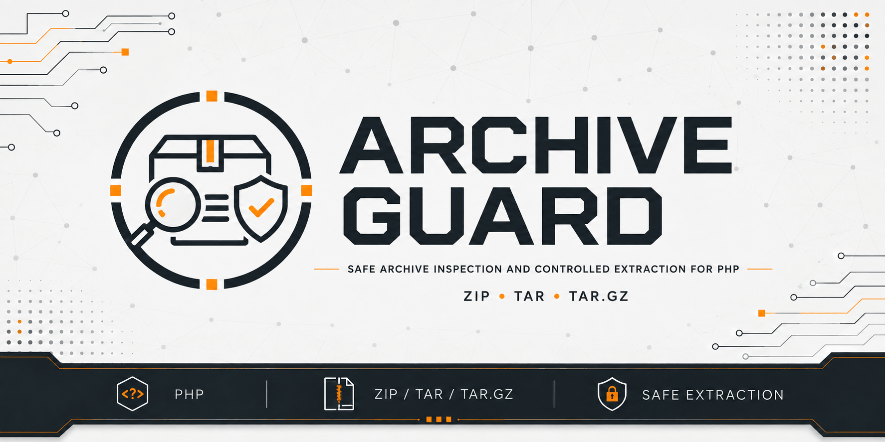

# Archive Guard

[](https://github.com/yaleksandr89/archive-guard)
[](https://github.com/yaleksandr89/archive-guard/actions/workflows/ci.yml)
[](https://packagist.org/packages/yaleksandr89/archive-guard)
[](https://packagist.org/packages/yaleksandr89/archive-guard)
[](https://www.php.net/)
[](../../../LICENSE)



## Choose a language

| Русский | English | Español | 中文 | Français | Deutsch |
|---|---|---|---|---|---|
| [Русский](../../../README.md) | **Selected** | [Español](../es/README.md) | [中文](../zh/README.md) | [Français](../fr/README.md) | [Deutsch](../de/README.md) |

Archive Guard is a PHP library for inspecting ZIP, TAR, and TAR.GZ archives before unpacking
and extracting files with predefined limits.

## Why use this package

If an application receives an archive from a user or an external service, it is useful to
check before unpacking that the archive does not contain unsafe paths, links, or unsupported
elements, and that its size and unpacked data volume stay within the application's limits.

The package lets you inspect an archive separately before unpacking, or inspect and extract
its contents in one operation. If the archive fails inspection, the application receives a
specific reason.

## What the package does

- detects the format from file contents rather than the filename extension;
- checks archive paths, collisions after normalization, and compatibility of names with the current platform;
- rejects symbolic and hard links, special objects, and unsupported archive features;
- enforces maximum archive size, entry count, individual unpacked entry size, and total unpacked volume;
- checks actual readability of accepted ZIP contents, not just metadata;
- inspects and extracts encrypted ZIP files with a supplied password where the current `ZipArchive`/`libzip` supports the encryption method;
- extracts by Atomic publication into a new directory or by Merge into an existing directory using `Reject`, `Skip`, or `Overwrite`;
- returns typed results and structured rejection reasons.

See the [supported archives reference](reference/supported-archives.md) for ZIP, TAR, and TAR.GZ differences.

## Requirements

- PHP `^8.4`;
- `ext-zip`;
- `ext-zlib`.

## Quick start

### Inspect an archive

[`ArchiveGuard::inspect()`](../../../src/ArchiveGuard.php) inspects an archive without extracting
files. Limits are configured through [`ArchivePolicy`](../../../src/ArchivePolicy.php).

<details>
<summary>Show inspection example</summary>

```php
<?php

use Yaleksandr\ArchiveGuard\ArchiveGuard;
use Yaleksandr\ArchiveGuard\ArchivePolicy;

$archivePath = '/path/to/archive.zip';

// Choose limits that match the real archives and resources of your application.
$policy = new ArchivePolicy(
    maxArchiveBytes: 50_000_000,
    maxEntries: 1_000,
    maxEntryUncompressedBytes: 10_000_000,
    maxTotalUncompressedBytes: 100_000_000,
);

$inspection = new ArchiveGuard()->inspect($archivePath, $policy);

if ($inspection->isAccepted()) {
    echo 'Archive passed inspection.' . PHP_EOL;
} else {
    foreach ($inspection->violations() as $violation) {
        // code identifies the rejection reason; message contains its text description.
        echo $violation->code->value . ': ' . $violation->message . PHP_EOL;
    }
}
```

</details>

Encrypted ZIP archives can be inspected by passing a password to the same method:

```php
$inspection = new ArchiveGuard()->inspect(
    $archivePath,
    $policy,
    password: $password,
);
```

`password` is only for ZIP. TAR and TAR.GZ have no built-in password encryption; supplying a non-null password for either format throws `InvalidArgumentException`.

The values above are only for demonstration. Choose them according to the archive sizes your
application actually expects. The inspection flow is described in detail in the
[`inspect()` guide](guides/inspection.md).

### Extract files

[`ArchiveGuard::extract()`](../../../src/ArchiveGuard.php) checks the current archive again rather than treating an earlier `inspect()` result as permission to apply files. Select the mode explicitly using [`ExtractionOptions`](../../../src/ExtractionOptions.php).

Atomic requires the final destination directory not to exist. The library creates its staging directory automatically inside the destination's parent.

<details>
<summary>Show extraction example</summary>

```php
<?php

use Yaleksandr\ArchiveGuard\ArchiveGuard;
use Yaleksandr\ArchiveGuard\ArchivePolicy;
use Yaleksandr\ArchiveGuard\ExtractionOptions;

$archivePath = '/path/to/archive.zip';
$destinationPath = '/path/to/result';

// Choose limits that match the real archives and resources of your application.
$policy = new ArchivePolicy(
    maxArchiveBytes: 50_000_000,
    maxEntries: 1_000,
    maxEntryUncompressedBytes: 10_000_000,
    maxTotalUncompressedBytes: 100_000_000,
);

$result = new ArchiveGuard()->extract(
    $archivePath,
    $destinationPath,
    $policy,
    ExtractionOptions::atomic(),
);

echo 'Files: ' . $result->filesExtracted() . PHP_EOL;
echo 'Directories: ' . $result->directoriesCreated() . PHP_EOL;
echo 'Bytes written: ' . $result->bytesWritten() . PHP_EOL;
```

</details>

For an existing directory, use `ExtractionOptions::merge(...)` with `Reject`, `Skip`, or `Overwrite`. The `extract()` call rechecks the current `archivePath`, `ArchivePolicy`, and `password`; destination-specific and mode-specific conditions are checked separately.

The [extraction guide](guides/extraction.md) describes Atomic, Merge, cooperative locks, conflicts, and error behavior in detail.

## Inspection policy

[`ArchivePolicy`](../../../src/ArchivePolicy.php) defines upper limits beyond which an archive
is rejected:

- maximum archive file size;
- maximum number of files and folders inside the archive; for TAR, some format metadata
  elements are included in the same limit;
- maximum size of one file after unpacking;
- maximum total size of all unpacked data;
- optional limit on the ratio of unpacked size to compressed size.

There are no universal values: an acceptable archive for avatar uploads and an acceptable
backup archive will need different limits. All parameters and their rules are described in the
[policy reference](reference/policy-and-errors.md).

## Violations and errors

If an archive is recognized but does not pass the configured checks,
[`inspect()`](../../../src/ArchiveGuard.php) returns an
[`InspectionResult`](../../../src/InspectionResult.php) with violations.

Exceptions describe other failures:

- [`ArchiveOpenException`](../../../src/Exception/ArchiveOpenException.php): source cannot be opened, format is unknown, structure is corrupt, or accepted unencrypted ZIP content cannot be read reliably;
- [`ArchiveRejectedException`](../../../src/Exception/ArchiveRejectedException.php): archive checks failed before Atomic publication or Merge application;
- [`ExtractionException`](../../../src/Exception/ExtractionException.php): destination, cooperative lock, staging, publication, Merge application, or filesystem I/O failure.

<details>
<summary>Show error handling example</summary>

```php
<?php

use Yaleksandr\ArchiveGuard\ArchiveGuard;
use Yaleksandr\ArchiveGuard\Exception\ArchiveOpenException;
use Yaleksandr\ArchiveGuard\Exception\ArchiveRejectedException;
use Yaleksandr\ArchiveGuard\Exception\ExtractionException;
use Yaleksandr\ArchiveGuard\ArchivePolicy;
use Yaleksandr\ArchiveGuard\ExtractionOptions;

$archivePath = '/path/to/archive.zip';
$destinationPath = '/path/to/result';

$policy = new ArchivePolicy(
    maxArchiveBytes: 50_000_000,
    maxEntries: 1_000,
    maxEntryUncompressedBytes: 10_000_000,
    maxTotalUncompressedBytes: 100_000_000,
);

$guard = new ArchiveGuard();

try {
    $result = $guard->extract(
        $archivePath,
        $destinationPath,
        $policy,
        ExtractionOptions::atomic(),
    );
} catch (ArchiveRejectedException $e) {
    // The archive was read, but it did not pass the configured checks.
    foreach ($e->inspectionResult()->violations() as $violation) {
        echo $violation->code->value . PHP_EOL;
    }
} catch (ArchiveOpenException $e) {
    // The file cannot be opened or the archive has an invalid structure.
    echo $e->getMessage() . PHP_EOL;
} catch (ExtractionException $e) {
    // The destination or filesystem operation could not be completed.
    echo $e->getMessage() . PHP_EOL;
}
```

</details>

The full list of violation codes and exceptions is available in the
[errors reference](reference/policy-and-errors.md).

## Security

Archive Guard checks paths and entry types, `ArchivePolicy` limits, platform-specific names, and actual ZIP readability. It automatically creates a staging directory in the destination's parent.

Atomic uses `rename()` to publish complete staging into a new destination after successful checks; failure before publication removes staging. Merge prepares the archive, checks conflicts, and applies `Reject`, `Skip`, or `Overwrite` to an existing directory. Merge is not transactional: changes applied before a filesystem failure remain. Its staging directory is removed when the operation finishes.

Both modes use a cooperative Archive Guard lock, not a lock against arbitrary external writers. The application must control destination permissions and concurrent external modifications.

Additional practical boundaries:

- Archive permissions, ownership, and modification times are not restored; only contents and directory structure are extracted.
- On Windows, deterministic filename restrictions are checked during `inspect()`, while checks depending on the actual destination filesystem occur in `extract()`.
- Merge requires appropriate permissions on each affected object's parent directory; preserving an existing file with `Skip` does not require write access solely for that file.


The [security model](security-model.md) explains the checks and application responsibilities.

## Feedback

- reproducible bugs — [GitHub Issues](https://github.com/yaleksandr89/archive-guard/issues);
- usage questions and ideas — [GitHub Discussions](https://github.com/yaleksandr89/archive-guard/discussions).

---

<p align="center">
  If the package was useful, give it a star on GitHub so other developers can find it more easily. 🤘
</p>
