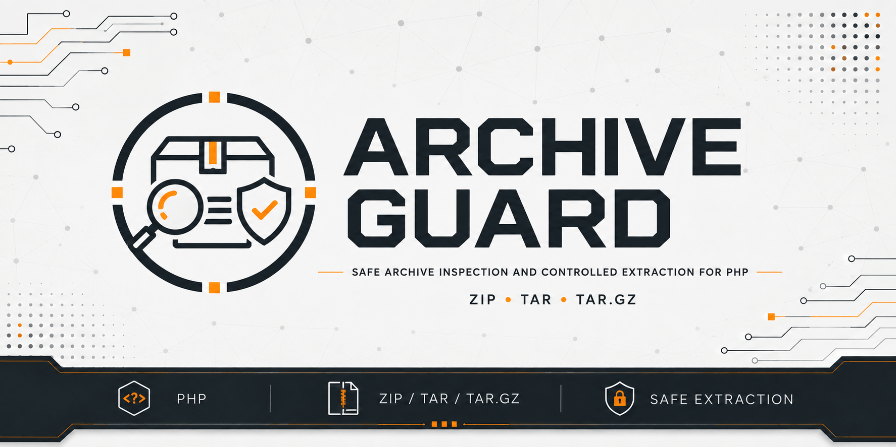

# Archive Guard

[](https://github.com/yaleksandr89/archive-guard)
[](https://github.com/yaleksandr89/archive-guard/actions/workflows/ci.yml)
[](https://packagist.org/packages/yaleksandr89/archive-guard)
[](https://packagist.org/packages/yaleksandr89/archive-guard)
[](https://www.php.net/)
[](../../../LICENSE)



## Elige un idioma

| Русский | English | Español | 中文 | Français | Deutsch |
|---|---|---|---|---|---|
| [Русский](../../../README.md) | [English](../en/README.md) | **Seleccionado** | [中文](../zh/README.md) | [Français](../fr/README.md) | [Deutsch](../de/README.md) |

Archive Guard es una biblioteca PHP para comprobar archivos ZIP, TAR y TAR.GZ antes de
descomprimirlos y extraer archivos con límites definidos de antemano.

## Para qué sirve el paquete

Si una aplicación recibe un archivo ZIP, TAR o TAR.GZ de un usuario o de un servicio externo,
conviene comprobar antes de descomprimir que no contiene rutas peligrosas, enlaces ni
elementos no compatibles, y que su tamaño y el volumen de datos descomprimidos se mantienen
dentro de los límites permitidos por la aplicación.

El paquete permite comprobar un archivo por separado antes de descomprimirlo o comprobarlo y
extraer su contenido en una sola operación. Si no supera la comprobación, la aplicación
recibe una causa concreta.

## Qué hace el paquete

- detecta el formato por contenido, no por extensión del nombre;
- comprueba rutas, conflictos tras normalización y compatibilidad de nombres con la plataforma actual;
- rechaza enlaces simbólicos y duros, objetos especiales y funciones de formato no compatibles;
- limita tamaño del archivo, cantidad de entradas, tamaño de cada entrada descomprimida y volumen total;
- comprueba la legibilidad real de contenido ZIP aceptado, no solo sus metadatos;
- permite comprobar y extraer ZIP cifrados con contraseña cuando el método es compatible con `ZipArchive`/`libzip` actual;
- extrae mediante Atomic a un directorio nuevo o Merge a uno existente con `Reject`, `Skip` u `Overwrite`;
- devuelve resultados tipados y motivos de rechazo estructurados.

Consulte los detalles en la [referencia de archivos compatibles](reference/supported-archives.md).

## Requisitos

- PHP `^8.4`;
- `ext-zip`;
- `ext-zlib`.

## Inicio rápido

### Comprobar un archivo

[`ArchiveGuard::inspect()`](../../../src/ArchiveGuard.php) comprueba el archivo sin extraer nada.
Los límites se configuran mediante [`ArchivePolicy`](../../../src/ArchivePolicy.php).

<details>
<summary>Mostrar ejemplo de comprobación</summary>

```php
<?php

use Yaleksandr\ArchiveGuard\ArchiveGuard;
use Yaleksandr\ArchiveGuard\ArchivePolicy;

$archivePath = '/path/to/archive.zip';

// Elige límites acordes con los archivos reales y los recursos de tu aplicación.
$policy = new ArchivePolicy(
    maxArchiveBytes: 50_000_000,
    maxEntries: 1_000,
    maxEntryUncompressedBytes: 10_000_000,
    maxTotalUncompressedBytes: 100_000_000,
);

$inspection = new ArchiveGuard()->inspect($archivePath, $policy);

if ($inspection->isAccepted()) {
    echo 'El archivo superó la comprobación.' . PHP_EOL;
} else {
    foreach ($inspection->violations() as $violation) {
        // code identifica la causa del rechazo; message contiene su descripción textual.
        echo $violation->code->value . ': ' . $violation->message . PHP_EOL;
    }
}
```

</details>

Para comprobar un ZIP cifrado, pase contraseña al mismo método:

```php
$inspection = new ArchiveGuard()->inspect(
    $archivePath,
    $policy,
    password: $password,
);
```

`password` solo se utiliza con ZIP. TAR y TAR.GZ no tienen cifrado por contraseña integrado; un valor distinto de `null` provoca `InvalidArgumentException`.

Los valores anteriores son solo de ejemplo. Debes elegirlos según el tamaño de los archivos
que realmente espera tu aplicación. El flujo de comprobación se explica con más detalle en la
[guía de `inspect()`](guides/inspection.md).

### Extraer archivos

[`ArchiveGuard::extract()`](../../../src/ArchiveGuard.php) vuelve a comprobar el archivo actual, sin tratar un `inspect()` anterior como permiso para aplicar cambios. El modo se elige explícitamente mediante [`ExtractionOptions`](../../../src/ExtractionOptions.php).

Atomic requiere que el directorio final aún no exista. La biblioteca crea automáticamente su área temporal en el directorio padre del destino.

<details>
<summary>Mostrar ejemplo de extracción</summary>

```php
<?php

use Yaleksandr\ArchiveGuard\ArchiveGuard;
use Yaleksandr\ArchiveGuard\ArchivePolicy;
use Yaleksandr\ArchiveGuard\ExtractionOptions;

$archivePath = '/path/to/archive.zip';
$destinationPath = '/path/to/result';

// Elige límites acordes con los archivos reales y los recursos de tu aplicación.
$policy = new ArchivePolicy(
    maxArchiveBytes: 50_000_000,
    maxEntries: 1_000,
    maxEntryUncompressedBytes: 10_000_000,
    maxTotalUncompressedBytes: 100_000_000,
);

$result = new ArchiveGuard()->extract(
    $archivePath,
    $destinationPath,
    $policy,
    ExtractionOptions::atomic(),
);

echo 'Archivos: ' . $result->filesExtracted() . PHP_EOL;
echo 'Directorios: ' . $result->directoriesCreated() . PHP_EOL;
echo 'Bytes escritos: ' . $result->bytesWritten() . PHP_EOL;
```

</details>

Para un directorio existente, use `ExtractionOptions::merge(...)` con `Reject`, `Skip` u `Overwrite`. `extract()` comprueba de nuevo `archivePath`, `ArchivePolicy` y `password`; las condiciones del destino y del modo se verifican por separado.

La [guía de extracción](guides/extraction.md) describe Atomic, Merge, bloqueos cooperativos, conflictos y errores.

## Política de comprobación

[`ArchivePolicy`](../../../src/ArchivePolicy.php) define límites superiores a partir de los
cuales se rechaza el archivo:

- tamaño máximo del archivo;
- cantidad máxima de archivos y carpetas en su interior; en TAR, algunos elementos de
  metadatos del formato también cuentan dentro de este límite;
- tamaño máximo de un solo archivo tras la descompresión;
- tamaño máximo total de todos los datos descomprimidos;
- límite opcional de la relación entre tamaño descomprimido y tamaño comprimido.

No existen valores universales: un archivo aceptable para subir avatares y una copia de
seguridad aceptable necesitarán límites distintos. Todos los parámetros y sus reglas se
describen en la [referencia de la política](reference/policy-and-errors.md).

## Infracciones y errores

Si el formato se reconoce pero el archivo no supera las comprobaciones configuradas,
[`inspect()`](../../../src/ArchiveGuard.php) devuelve un
[`InspectionResult`](../../../src/InspectionResult.php) con las infracciones.

Las excepciones describen fallos diferentes:

- [`ArchiveOpenException`](../../../src/Exception/ArchiveOpenException.php): el origen no se abre, el formato es desconocido, la estructura está dañada o no se puede leer contenido ZIP sin cifrar ya aceptado;
- [`ArchiveRejectedException`](../../../src/Exception/ArchiveRejectedException.php): la comprobación rechazó el archivo antes de publicar Atomic o aplicar Merge;
- [`ExtractionException`](../../../src/Exception/ExtractionException.php): fallo de destino, bloqueo, área temporal, publicación, aplicación Merge o E/S.

<details>
<summary>Mostrar ejemplo de gestión de errores</summary>

```php
<?php

use Yaleksandr\ArchiveGuard\ArchiveGuard;
use Yaleksandr\ArchiveGuard\Exception\ArchiveOpenException;
use Yaleksandr\ArchiveGuard\Exception\ArchiveRejectedException;
use Yaleksandr\ArchiveGuard\Exception\ExtractionException;
use Yaleksandr\ArchiveGuard\ArchivePolicy;
use Yaleksandr\ArchiveGuard\ExtractionOptions;

$archivePath = '/path/to/archive.zip';
$destinationPath = '/path/to/result';

$policy = new ArchivePolicy(
    maxArchiveBytes: 50_000_000,
    maxEntries: 1_000,
    maxEntryUncompressedBytes: 10_000_000,
    maxTotalUncompressedBytes: 100_000_000,
);

$guard = new ArchiveGuard();

try {
    $result = $guard->extract(
        $archivePath,
        $destinationPath,
        $policy,
        ExtractionOptions::atomic(),
    );
} catch (ArchiveRejectedException $e) {
    // El archivo se leyó, pero no superó las comprobaciones configuradas.
    foreach ($e->inspectionResult()->violations() as $violation) {
        echo $violation->code->value . PHP_EOL;
    }
} catch (ArchiveOpenException $e) {
    // El archivo no se puede abrir o su estructura no es válida.
    echo $e->getMessage() . PHP_EOL;
} catch (ExtractionException $e) {
    // El archivo superó la comprobación, pero no se pudo completar la extracción.
    echo $e->getMessage() . PHP_EOL;
}
```

</details>

La lista completa de códigos de infracción y excepciones está disponible en la
[referencia de errores](reference/policy-and-errors.md).

## Seguridad

Archive Guard comprueba rutas, tipos de entradas, límites `ArchivePolicy`, nombres de la plataforma y legibilidad real de ZIP. Crea automáticamente un directorio temporal en el padre del destino.

Atomic publica el resultado completo en un directorio nuevo con `rename()` después de las comprobaciones; si falla antes de publicar, se elimina el temporal. Merge prepara el archivo, verifica los conflictos y aplica `Reject`, `Skip` u `Overwrite` a un directorio existente. Merge no es transaccional: los cambios ya aplicados permanecen si aparece un error de E/S. El área temporal se elimina al terminar.

Ambos modos usan un bloqueo cooperativo Archive Guard que no impide escrituras de procesos externos arbitrarios. La aplicación debe controlar permisos y cambios concurrentes del destino.

Otros límites prácticos:

- No se restauran los permisos, propietario ni fechas de modificación del archivo; se extraen el contenido y la estructura de directorios.
- En Windows, `inspect()` comprueba los nombres incompatibles de forma determinista y `extract()` verifica las condiciones del sistema de archivos del destino real.
- Merge necesita permisos adecuados en el padre de cada objeto afectado; con `Skip` no hace falta permiso de escritura solo para el archivo que se conserva.


Encontrará todos los detalles en el [modelo de seguridad](security-model.md).

## Comentarios y ayuda

- errores reproducibles — [GitHub Issues](https://github.com/yaleksandr89/archive-guard/issues);
- preguntas de uso e ideas — [GitHub Discussions](https://github.com/yaleksandr89/archive-guard/discussions).

---

<p align="center">
  Si el paquete te resultó útil, dale una estrella en GitHub para que otros desarrolladores puedan encontrarlo más fácilmente. 🤘
</p>
