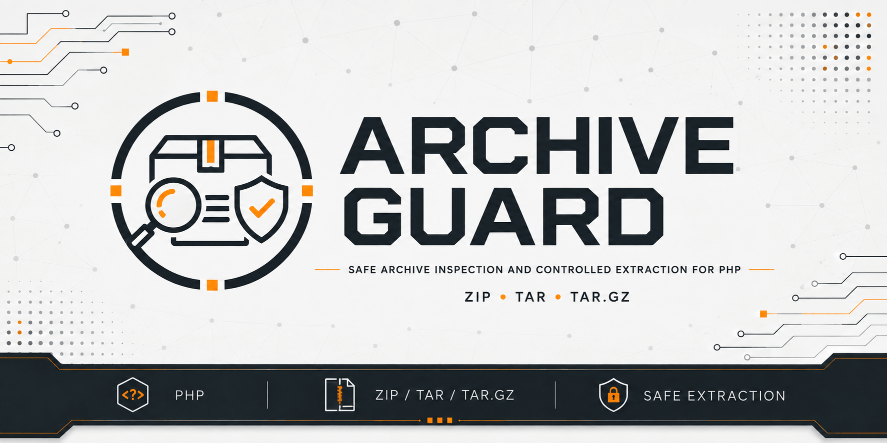

# Archive Guard

[](https://github.com/yaleksandr89/archive-guard)
[](https://github.com/yaleksandr89/archive-guard/actions/workflows/ci.yml)
[](https://packagist.org/packages/yaleksandr89/archive-guard)
[](https://packagist.org/packages/yaleksandr89/archive-guard)
[](https://www.php.net/)
[](../../../LICENSE)



## Choisir une langue

| Русский | English | Español | 中文 | Français | Deutsch |
|---|---|---|---|---|---|
| [Русский](../../../README.md) | [English](../en/README.md) | [Español](../es/README.md) | [中文](../zh/README.md) | **Sélectionné** | [Deutsch](../de/README.md) |

Archive Guard est une bibliothèque PHP permettant de vérifier les archives ZIP, TAR et TAR.GZ
avant leur décompression et d'extraire les fichiers avec des limites définies à l'avance.

## À quoi sert le paquet

Si une application reçoit une archive d'un utilisateur ou d'un service externe, il est utile
de vérifier avant la décompression qu'elle ne contient pas de chemins dangereux, de liens ou
d'éléments non pris en charge, et que sa taille ainsi que le volume des données décompressées
restent dans les limites autorisées par l'application.

Le paquet permet soit de vérifier une archive séparément avant de la décompresser, soit de la
vérifier et d'en extraire le contenu en une seule opération. Si l'archive échoue à la
vérification, l'application reçoit une raison précise.

## Ce que fait le paquet

- détecte le format à partir du contenu plutôt que de l'extension ;
- vérifie les chemins, les collisions après normalisation et la compatibilité des noms avec la plateforme ;
- refuse liens symboliques et physiques, objets spéciaux et fonctionnalités de format non prises en charge ;
- limite la taille de l'archive, le nombre d'éléments, la taille décompressée de chacun et le volume total ;
- vérifie la lisibilité réelle du contenu ZIP accepté, pas seulement les métadonnées ;
- vérifie et extrait les ZIP chiffrés avec un mot de passe lorsque `ZipArchive`/`libzip` prend en charge la méthode ;
- extrait par Atomic dans un nouveau répertoire ou par Merge dans un répertoire existant avec `Reject`, `Skip` ou `Overwrite` ;
- fournit des résultats typés et des motifs de rejet structurés.

La [référence des archives prises en charge](reference/supported-archives.md) détaille ZIP, TAR et TAR.GZ.

## Prérequis

- PHP `>=8.4 <8.6` ;
- `ext-zip` ;
- `ext-zlib`.

## Démarrage rapide

### Vérifier une archive

[`ArchiveGuard::inspect()`](../../../src/ArchiveGuard.php) vérifie l'archive sans extraire de
fichiers. Les limites sont configurées avec
[`ArchivePolicy`](../../../src/ArchivePolicy.php).

<details>
<summary>Afficher l'exemple de vérification</summary>

```php
<?php

use Yaleksandr\ArchiveGuard\ArchiveGuard;
use Yaleksandr\ArchiveGuard\ArchivePolicy;

$archivePath = '/path/to/archive.zip';

// Choisissez des limites adaptées aux archives réelles et aux ressources de l'application.
$policy = new ArchivePolicy(
    maxArchiveBytes: 50_000_000,
    maxEntries: 1_000,
    maxEntryUncompressedBytes: 10_000_000,
    maxTotalUncompressedBytes: 100_000_000,
);

$inspection = new ArchiveGuard()->inspect($archivePath, $policy);

if ($inspection->isAccepted()) {
    echo 'L\'archive a réussi la vérification.' . PHP_EOL;
} else {
    foreach ($inspection->violations() as $violation) {
        // code indique la cause du rejet ; message contient sa description textuelle.
        echo $violation->code->value . ': ' . $violation->message . PHP_EOL;
    }
}
```

</details>

Pour vérifier un ZIP chiffré, transmettez le mot de passe à la même méthode :

```php
$inspection = new ArchiveGuard()->inspect(
    $archivePath,
    $policy,
    password: $password,
);
```

`password` concerne uniquement ZIP. TAR et TAR.GZ ne possèdent pas de chiffrement par mot de passe intégré ; une valeur non nulle provoque `InvalidArgumentException`.

Les valeurs ci-dessus servent uniquement d'exemple. Choisissez-les en fonction de la taille
des archives réellement attendues par votre application. Le scénario de vérification est
décrit en détail dans le [guide de `inspect()`](guides/inspection.md).

### Extraire des fichiers

[`ArchiveGuard::extract()`](../../../src/ArchiveGuard.php) vérifie de nouveau l'archive actuelle : un `inspect()` antérieur n'autorise pas l'écriture. Le mode est choisi explicitement au moyen de [`ExtractionOptions`](../../../src/ExtractionOptions.php).

Atomic exige que le répertoire final n'existe pas encore. La bibliothèque crée automatiquement l'espace temporaire dans le parent de la destination.

<details>
<summary>Afficher l'exemple d'extraction</summary>

```php
<?php

use Yaleksandr\ArchiveGuard\ArchiveGuard;
use Yaleksandr\ArchiveGuard\ArchivePolicy;
use Yaleksandr\ArchiveGuard\ExtractionOptions;

$archivePath = '/path/to/archive.zip';
$destinationPath = '/path/to/result';

// Choisissez des limites adaptées aux archives réelles et aux ressources de l'application.
$policy = new ArchivePolicy(
    maxArchiveBytes: 50_000_000,
    maxEntries: 1_000,
    maxEntryUncompressedBytes: 10_000_000,
    maxTotalUncompressedBytes: 100_000_000,
);

$result = new ArchiveGuard()->extract(
    $archivePath,
    $destinationPath,
    $policy,
    ExtractionOptions::atomic(),
);

echo 'Fichiers : ' . $result->filesExtracted() . PHP_EOL;
echo 'Répertoires : ' . $result->directoriesCreated() . PHP_EOL;
echo 'Octets écrits : ' . $result->bytesWritten() . PHP_EOL;
```

</details>

Pour un répertoire existant, utilisez `ExtractionOptions::merge(...)` avec `Reject`, `Skip` ou `Overwrite`. `extract()` revérifie `archivePath`, `ArchivePolicy` et `password` ; les conditions du répertoire et du mode sont contrôlées séparément.

Le [guide d'extraction](guides/extraction.md) détaille Atomic, Merge, les verrous coopératifs, les conflits et les erreurs.

## Politique de vérification

[`ArchivePolicy`](../../../src/ArchivePolicy.php) définit les limites supérieures au-delà
desquelles une archive est rejetée :

- taille maximale du fichier d'archive ;
- nombre maximal de fichiers et dossiers dans l'archive ; pour TAR, certains éléments de
  métadonnées du format sont comptés dans la même limite ;
- taille maximale d'un fichier après décompression ;
- taille totale maximale de toutes les données décompressées ;
- limite facultative du rapport entre taille décompressée et taille compressée.

Il n'existe pas de valeurs universelles : une archive acceptable pour l'envoi d'un avatar et
une archive de sauvegarde acceptable nécessiteront des limites différentes. Tous les paramètres
et leurs règles sont décrits dans la
[référence de la politique](reference/policy-and-errors.md).

## Violations et erreurs

Si une archive est reconnue mais ne passe pas les vérifications configurées,
[`inspect()`](../../../src/ArchiveGuard.php) renvoie un
[`InspectionResult`](../../../src/InspectionResult.php) contenant les violations.

Les exceptions signalent d'autres erreurs :

- [`ArchiveOpenException`](../../../src/Exception/ArchiveOpenException.php) : source impossible à ouvrir, format inconnu, structure corrompue ou contenu ZIP non chiffré accepté mais illisible ;
- [`ArchiveRejectedException`](../../../src/Exception/ArchiveRejectedException.php) : l'archive a été refusée avant publication Atomic ou application Merge ;
- [`ExtractionException`](../../../src/Exception/ExtractionException.php) : erreur de destination, verrou, espace temporaire, publication, application Merge ou E/S.

<details>
<summary>Afficher l'exemple de gestion des erreurs</summary>

```php
<?php

use Yaleksandr\ArchiveGuard\ArchiveGuard;
use Yaleksandr\ArchiveGuard\Exception\ArchiveOpenException;
use Yaleksandr\ArchiveGuard\Exception\ArchiveRejectedException;
use Yaleksandr\ArchiveGuard\Exception\ExtractionException;
use Yaleksandr\ArchiveGuard\ArchivePolicy;
use Yaleksandr\ArchiveGuard\ExtractionOptions;

$archivePath = '/path/to/archive.zip';
$destinationPath = '/path/to/result';

$policy = new ArchivePolicy(
    maxArchiveBytes: 50_000_000,
    maxEntries: 1_000,
    maxEntryUncompressedBytes: 10_000_000,
    maxTotalUncompressedBytes: 100_000_000,
);

$guard = new ArchiveGuard();

try {
    $result = $guard->extract(
        $archivePath,
        $destinationPath,
        $policy,
        ExtractionOptions::atomic(),
    );
} catch (ArchiveRejectedException $e) {
    // L'archive a été lue, mais elle n'a pas réussi les vérifications configurées.
    foreach ($e->inspectionResult()->violations() as $violation) {
        echo $violation->code->value . PHP_EOL;
    }
} catch (ArchiveOpenException $e) {
    // Le fichier ne peut pas être ouvert ou la structure de l'archive est invalide.
    echo $e->getMessage() . PHP_EOL;
} catch (ExtractionException $e) {
    // L'archive a réussi la vérification, mais l'extraction n'a pas pu être terminée.
    echo $e->getMessage() . PHP_EOL;
}
```

</details>

La liste complète des codes de violation et des exceptions est disponible dans la
[référence des erreurs](reference/policy-and-errors.md).

## Sécurité

Archive Guard vérifie les chemins, types d'éléments, limites `ArchivePolicy`, noms de la plateforme et lisibilité réelle du contenu ZIP. La bibliothèque crée automatiquement un répertoire temporaire dans le parent de la destination.

Atomic publie avec `rename()` un résultat complet dans un nouveau répertoire après les vérifications ; une erreur avant publication supprime l'espace temporaire. Merge prépare l'archive, vérifie les conflits et applique `Reject`, `Skip` ou `Overwrite` à un répertoire existant. Merge n'est pas transactionnel : les changements déjà appliqués restent après une erreur du système de fichiers. Son espace temporaire est supprimé à la fin.

Les deux modes utilisent un verrou coopératif Archive Guard et non une exclusion de tous les processus externes. L'application reste responsable des permissions et des modifications concurrentes.

Autres limites pratiques :

- Les permissions, le propriétaire et les dates de modification de l'archive ne sont pas restaurés ; seuls les contenus et répertoires sont extraits.
- Sous Windows, `inspect()` vérifie les restrictions déterministes des noms et `extract()` les conditions liées au vrai système de fichiers de destination.
- Merge requiert des permissions sur le parent de chaque objet modifié ; avec `Skip`, la conservation d'un fichier n'exige pas de permission d'écriture uniquement pour ce fichier.


Le [modèle de sécurité](security-model.md) présente les détails.

## Retours

- bugs reproductibles — [GitHub Issues](https://github.com/yaleksandr89/archive-guard/issues) ;
- questions d'utilisation et idées — [GitHub Discussions](https://github.com/yaleksandr89/archive-guard/discussions).

---

<p align="center">
  Si le paquet vous a été utile, ajoutez une étoile sur GitHub pour aider d'autres développeurs à le trouver. 🤘
</p>
