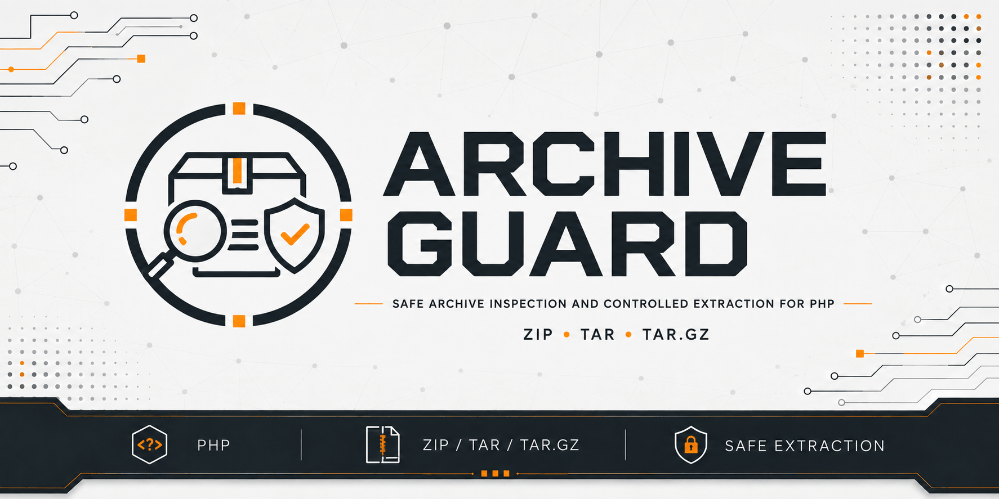

# Archive Guard

[](https://github.com/yaleksandr89/archive-guard)
[](https://github.com/yaleksandr89/archive-guard/actions/workflows/ci.yml)
[](https://packagist.org/packages/yaleksandr89/archive-guard)
[](https://packagist.org/packages/yaleksandr89/archive-guard)
[](https://www.php.net/)
[](../../../LICENSE)



## 选择语言

| Русский | English | Español | 中文 | Français | Deutsch |
|---|---|---|---|---|---|
| [Русский](../../../README.md) | [English](../en/README.md) | [Español](../es/README.md) | **已选择** | [Français](../fr/README.md) | [Deutsch](../de/README.md) |

Archive Guard 是一个 PHP 库，用于在解压 ZIP、TAR 和 TAR.GZ 之前进行检查，并按照预先设定的限制提取文件。

## 这个包解决什么问题

如果应用会接收用户或外部服务提供的归档文件，那么在解压前最好先确认其中没有危险路径、链接或不受支持的元素，
并确认归档文件大小和解压后的数据量都处于应用允许的范围内。

这个包既可以在解压前单独检查归档文件，也可以在一次操作中完成检查和提取。
如果归档文件未通过检查，应用会得到明确的原因。

## 这个包会做什么

- 根据文件内容而不是扩展名识别格式；
- 检查归档路径、规范化后的冲突和当前平台的名称兼容性；
- 拒绝符号链接、硬链接、特殊对象和不支持的格式功能；
- 限制源归档大小、条目数、单条目解压大小和解压总量；
- 验证已接受 ZIP 内容的实际可读性，而不只检查元数据；
- 在当前 `ZipArchive`/`libzip` 支持加密方法时，通过密码检查和提取加密 ZIP；
- 使用 Atomic 发布到新目录，或使用 Merge 以 `Reject`、`Skip`、`Overwrite` 策略合并到现有目录；
- 返回带类型的结果和结构化拒绝原因。

ZIP、TAR、TAR.GZ 的区别参阅[支持的归档参考](reference/supported-archives.md)。

## 要求

- PHP `>=8.4 <8.6`;
- `ext-zip`;
- `ext-zlib`.

## 快速开始

### 检查归档文件

[`ArchiveGuard::inspect()`](../../../src/ArchiveGuard.php) 只检查归档文件，不会向磁盘提取文件。
限制通过 [`ArchivePolicy`](../../../src/ArchivePolicy.php) 配置。

<details>
<summary>查看检查示例</summary>

```php
<?php

use Yaleksandr\ArchiveGuard\ArchiveGuard;
use Yaleksandr\ArchiveGuard\ArchivePolicy;

$archivePath = '/path/to/archive.zip';

// 请根据应用实际处理的归档文件和可用资源设置限制。
$policy = new ArchivePolicy(
    maxArchiveBytes: 50_000_000,
    maxEntries: 1_000,
    maxEntryUncompressedBytes: 10_000_000,
    maxTotalUncompressedBytes: 100_000_000,
);

$inspection = new ArchiveGuard()->inspect($archivePath, $policy);

if ($inspection->isAccepted()) {
    echo '归档文件已通过检查。' . PHP_EOL;
} else {
    foreach ($inspection->violations() as $violation) {
        // code 表示拒绝原因，message 提供对应的文字说明。
        echo $violation->code->value . ': ' . $violation->message . PHP_EOL;
    }
}
```

</details>

检查加密 ZIP 时，可以向相同方法传入密码：

```php
$inspection = new ArchiveGuard()->inspect(
    $archivePath,
    $policy,
    password: $password,
);
```

`password` 仅用于 ZIP。TAR 和 TAR.GZ 没有内置密码加密；对它们传入非 `null` 密码会抛出 `InvalidArgumentException`。


以上数值仅用于演示。实际值应根据应用真正预期接收的归档文件大小来设置。
完整检查流程请参阅 [`inspect()` 指南](guides/inspection.md)。

### 提取文件

[`ArchiveGuard::extract()`](../../../src/ArchiveGuard.php) 会重新检查当前归档，不会把较早的 `inspect()` 结果当作写入许可。必须通过 [`ExtractionOptions`](../../../src/ExtractionOptions.php) 明确指定模式。

Atomic 要求最终目标目录事先不存在。库会自动在目标父目录创建暂存目录。

<details>
<summary>查看提取示例</summary>

```php
<?php

use Yaleksandr\ArchiveGuard\ArchiveGuard;
use Yaleksandr\ArchiveGuard\ArchivePolicy;
use Yaleksandr\ArchiveGuard\ExtractionOptions;

$archivePath = '/path/to/archive.zip';
$destinationPath = '/path/to/result';

// 请根据应用实际处理的归档文件和可用资源设置限制。
$policy = new ArchivePolicy(
    maxArchiveBytes: 50_000_000,
    maxEntries: 1_000,
    maxEntryUncompressedBytes: 10_000_000,
    maxTotalUncompressedBytes: 100_000_000,
);

$result = new ArchiveGuard()->extract(
    $archivePath,
    $destinationPath,
    $policy,
    ExtractionOptions::atomic(),
);

echo '文件数：' . $result->filesExtracted() . PHP_EOL;
echo '目录数：' . $result->directoriesCreated() . PHP_EOL;
echo '写入字节数：' . $result->bytesWritten() . PHP_EOL;
```

</details>

对于现有目录，使用 `ExtractionOptions::merge(...)` 并选择 `Reject`、`Skip` 或 `Overwrite`。`extract()` 再次检查当前的 `archivePath`、`ArchivePolicy` 和 `password`；目标与模式有关的条件另外检查。

[提取指南](guides/extraction.md)详细解释 Atomic、Merge、协作锁、冲突与错误语义。

## 检查策略

[`ArchivePolicy`](../../../src/ArchivePolicy.php) 定义归档文件一旦超过就会被拒绝的上限：

- 归档文件的最大大小；
- 归档文件内文件和文件夹的最大数量；对于 TAR，一些格式元数据元素也计入同一限制；
- 单个文件解压后的最大大小；
- 所有解压数据的最大总量；
- 可选的“解压后大小与压缩后大小之比”上限。

这些值不存在通用答案：头像上传可接受的归档文件和备份文件可接受的归档文件需要不同限制。
所有参数及规则请参阅[策略参考](reference/policy-and-errors.md)。

## 违规与错误

如果归档文件格式能够识别，但未通过配置的检查，
[`inspect()`](../../../src/ArchiveGuard.php) 会返回包含违规信息的
[`InspectionResult`](../../../src/InspectionResult.php)。

异常用于另一类失败：

其他失败使用异常表示：

- [`ArchiveOpenException`](../../../src/Exception/ArchiveOpenException.php)：源文件打不开、格式未知、结构损坏，或已接受的未加密 ZIP 内容无法可靠读取；
- [`ArchiveRejectedException`](../../../src/Exception/ArchiveRejectedException.php)：在 Atomic 发布或 Merge 应用前，归档检查拒绝了内容；
- [`ExtractionException`](../../../src/Exception/ExtractionException.php)：目标、锁、暂存目录、发布、Merge 应用或文件系统 I/O 出错。

<details>
<summary>查看错误处理示例</summary>

```php
<?php

use Yaleksandr\ArchiveGuard\ArchiveGuard;
use Yaleksandr\ArchiveGuard\Exception\ArchiveOpenException;
use Yaleksandr\ArchiveGuard\Exception\ArchiveRejectedException;
use Yaleksandr\ArchiveGuard\Exception\ExtractionException;
use Yaleksandr\ArchiveGuard\ArchivePolicy;
use Yaleksandr\ArchiveGuard\ExtractionOptions;

$archivePath = '/path/to/archive.zip';
$destinationPath = '/path/to/result';

$policy = new ArchivePolicy(
    maxArchiveBytes: 50_000_000,
    maxEntries: 1_000,
    maxEntryUncompressedBytes: 10_000_000,
    maxTotalUncompressedBytes: 100_000_000,
);

$guard = new ArchiveGuard();

try {
    $result = $guard->extract(
        $archivePath,
        $destinationPath,
        $policy,
        ExtractionOptions::atomic(),
    );
} catch (ArchiveRejectedException $e) {
    // 归档文件可以读取，但未通过配置的检查。
    foreach ($e->inspectionResult()->violations() as $violation) {
        echo $violation->code->value . PHP_EOL;
    }
} catch (ArchiveOpenException $e) {
    // 文件无法打开，或归档文件结构无效。
    echo $e->getMessage() . PHP_EOL;
} catch (ExtractionException $e) {
    // 归档文件通过了检查，但无法完成提取。
    echo $e->getMessage() . PHP_EOL;
}
```

</details>

完整的违规代码和异常列表请参阅
[错误参考](reference/policy-and-errors.md)。

## 安全性

Archive Guard 检查路径与条目类型、`ArchivePolicy` 限制、当前平台的名称以及 ZIP 的实际可读性。库会自动在目标父目录创建暂存目录。

Atomic 在检查成功后用 `rename()` 将完整结果发布到新目录；发布前失败会删除暂存目录。Merge 先准备全部内容并检查冲突，再以 `Reject`、`Skip` 或 `Overwrite` 应用到现有目录。Merge 不是事务性的：如果文件系统出错，先前已应用的更改仍然保留。暂存目录在操作结束后删除。

两种模式都使用 Archive Guard 协作锁，而不是针对任意外部写入者的系统锁。应用应管理目录权限以及外部进程的并发修改。

其他实际边界：

- 不恢复归档中的权限、所有者或修改时间，只提取文件内容与目录结构。
- 在 Windows 上，确定性名称限制由 `inspect()` 检查；依赖具体目标文件系统的条件由 `extract()` 检查。
- Merge 需要受影响对象父目录的相应权限；`Skip` 保留文件时不需要仅为该文件取得写权限。


详细限制参阅[安全模型](security-model.md)。

## 反馈

- 可复现的问题 — [GitHub Issues](https://github.com/yaleksandr89/archive-guard/issues);
- 使用问题和建议 — [GitHub Discussions](https://github.com/yaleksandr89/archive-guard/discussions).

---

<p align="center">
  如果这个包对你有帮助，请在 GitHub 上给它一个 Star，方便其他开发者发现它。🤘
</p>
